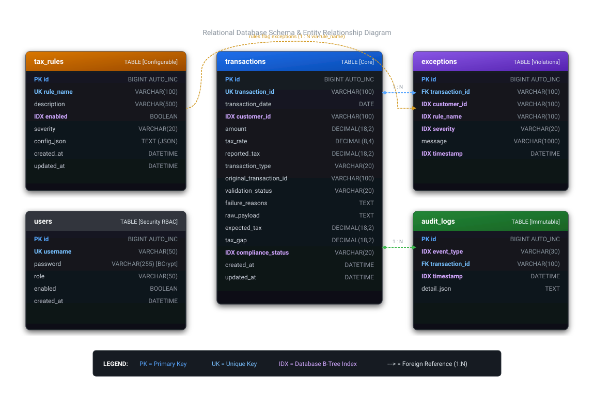
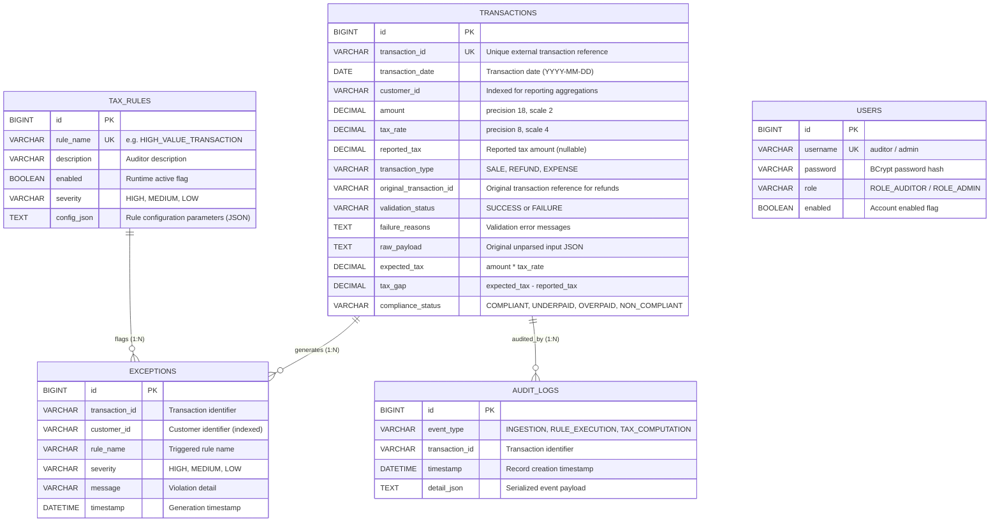
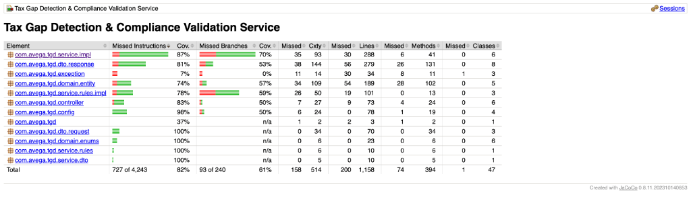

# Tax Gap Detection & Compliance Validation Service

[](https://openjdk.org/projects/jdk/17/)
[](https://spring.io/projects/spring-boot)
[](#test-coverage-report)
[](#test-coverage-report)
[](LICENSE)

> **Candidate / Developer:** Abhishek Kumar  
> **Repository:** [https://github.com/Abhishekkkkkkkkkkk/tax-gap-detection-service](https://github.com/Abhishekkkkkkkkkkk/tax-gap-detection-service)  
> **Assessment Deliverable:** Backend Development Assessment (Spring Boot & REST APIs)

---

## Overview

This repository contains my submission for the Tax Gap Detection & Compliance Validation Service technical assessment.

The service is a Spring Boot application built to process financial transactions in bulk, detect discrepancies between reported and statutory tax amounts, execute configurable compliance rules, preserve an immutable audit trail, and serve real-time aggregation reports.

### Key Capabilities
- **Batch & Single Transaction Ingestion:** Ingests transaction records with per-record fault isolation. Malformed records fail individually without aborting the batch, and raw payloads are stored for forensic auditability.
- **Precision Tax Gap Calculation:** Evaluates `taxGap = expectedTax - reportedTax` using arbitrary-precision arithmetic (`BigDecimal`, `HALF_UP`) with a $\pm 1.00$ tolerance boundary to avoid false positives on legitimate rounding differences.
- **Dynamic Rule Engine (Strategy Pattern):** Evaluates pluggable compliance rules (`HIGH_VALUE_TRANSACTION`, `REFUND_VALIDATION`, `GST_SLAB_VIOLATION`). Active rules and threshold configurations are stored in the database and can be toggled or reconfigured via REST APIs without redeploying code.
- **Autonomous Audit Trail:** Logs ingestion events, tax calculations, and rule evaluations in independent physical database transactions (`REQUIRES_NEW`), ensuring the audit log is preserved even if the parent business transaction fails.
- **Exception Filtering:** Allows auditors to query compliance exceptions dynamically by severity, customer ID, rule name, and date range with pagination.
- **SQL-Level Aggregation Reports:** Uses JPQL `GROUP BY` and conditional `CASE` expressions with Spring Data interface projections to compute customer tax summaries and executive exception metrics directly inside the database engine.

---

## Table of Contents
1. [Technology Stack](#technology-stack)
2. [How to Run the Application](#how-to-run-the-application)
3. [Database Setup & Configuration](#database-setup--configuration)
4. [Authentication & Security Credentials](#authentication--security-credentials)
5. [Sample cURL Commands & Postman Collection](#sample-curl-commands--postman-collection)
6. [Sample Batch Upload JSON](#sample-batch-upload-json)
7. [Database Schema & ER Diagram](#database-schema--er-diagram)
8. [Test Coverage Report](#test-coverage-report)
9. [Architecture & Design Explanation](#architecture--design-explanation)
10. [Deliverables Checklist](#deliverables-checklist)

---

## Technology Stack

- **Language:** Java 17 (OpenJDK)
- **Framework:** Spring Boot 3.3.4
- **Persistence:** Spring Data JPA, Hibernate 6
- **Database Support:**
  - **MySQL 8.4** (Default configuration; Docker Compose file included)
  - **PostgreSQL 16** (Supported via `postgres` profile)
  - **H2 (File-based Persistent)** (Supported via `filedb` profile for standalone evaluation without external database setup)
- **Security:** Spring Security 6 (HTTP Basic Authentication, BCrypt password hashing, stateless sessions)
- **API Documentation:** OpenAPI 3 / Swagger UI (`springdoc-openapi-starter-webmvc-ui` 2.6.0)
- **Monitoring:** Spring Boot Actuator (`/actuator/health`)
- **Testing:** JUnit 5, Mockito, Spring Boot Test, JaCoCo (0.8.11)
- **Build Tool:** Apache Maven with Maven Wrapper (`./mvnw`)

---

## How to Run the Application

The repository includes the Maven Wrapper (`./mvnw` on macOS/Linux, `mvnw.cmd` on Windows), so you do not need Maven pre-installed.

### Prerequisites
- **Java 17 JDK** installed (`java -version` should show `17.x`).
- Optional: **Docker & Docker Compose** (if running with MySQL or PostgreSQL containers).

---

### Option 1: Standalone Evaluation with Persistent File Database (Fastest Local Verification)

If you want to evaluate the application immediately without starting Docker or installing MySQL, use the `filedb` profile. This runs an embedded H2 database configured in file-persistence mode (`jdbc:h2:file:./data/tgd_real_db`). All data is saved to disk under `./data/` and persists across application restarts.

**On macOS / Linux:**
```bash
./mvnw spring-boot:run -Dspring-boot.run.profiles=filedb
```

**On Windows (Command Prompt / PowerShell):**
```cmd
.\mvnw.cmd spring-boot:run -Dspring-boot.run.profiles=filedb
```

---

### Option 2: Running with MySQL (Default Profile via Docker Compose)

The default configuration (`application.properties`) points to MySQL on `localhost:3306`. A pre-configured `docker-compose.yml` is provided at the repository root.

1. **Start the MySQL container:**
   ```bash
   docker compose up -d mysql-db
   ```
2. **Run the application:**
   ```bash
   # macOS / Linux
   DB_PASSWORD=root ./mvnw spring-boot:run

   # Windows (Command Prompt)
   set DB_PASSWORD=root
   .\mvnw.cmd spring-boot:run

   # Windows (PowerShell)
   $env:DB_PASSWORD="root"; .\mvnw.cmd spring-boot:run
   ```

---

### Option 3: Running with PostgreSQL

1. **Start the PostgreSQL container:**
   ```bash
   docker compose up -d postgres-db
   ```
2. **Run the application with the PostgreSQL profile:**
   ```bash
   # macOS / Linux
   ./mvnw spring-boot:run -Dspring-boot.run.profiles=postgres

   # Windows
   .\mvnw.cmd spring-boot:run -Dspring-boot.run.profiles=postgres
   ```

---

### Option 4: Running in an IDE (IntelliJ IDEA / Eclipse / STS)

1. **Import:**
   - **IntelliJ IDEA:** Open the project folder &rarr; select `Trust Project` &rarr; Maven dependencies will sync automatically.
   - **Eclipse / Spring Tool Suite:** `File` &rarr; `Import...` &rarr; `Maven` &rarr; `Existing Maven Projects` &rarr; select root directory.
2. **JDK Setting:** Ensure Project SDK / JRE is set to **Java 17**.
3. **Run Configuration:**
   - Run `TaxGapDetectionApplication.java` (`src/main/java/com/avega/tgd/TaxGapDetectionApplication.java`).
   - To use the persistent file database, add `--spring.profiles.active=filedb` to the program arguments.

---

### Option 5: Build and Run the Packaged JAR

```bash
# Build the executable fat JAR (runs all 49 tests automatically)
./mvnw clean package

# Run with file database
java -jar target/tax-gap-detection-service-1.0.0.jar --spring.profiles.active=filedb

# Or run with MySQL
java -jar target/tax-gap-detection-service-1.0.0.jar --DB_PASSWORD=root
```

---

### Verification Endpoints

Once the application is running, the following endpoints are available:

- **Swagger UI (Interactive API documentation):** [http://localhost:8080/swagger-ui.html](http://localhost:8080/swagger-ui.html)
- **OpenAPI JSON specification:** [http://localhost:8080/v3/api-docs](http://localhost:8080/v3/api-docs)
- **Health Check:** [http://localhost:8080/actuator/health](http://localhost:8080/actuator/health) *(returns `{"status":"UP"}`)*
- **H2 Console (only active when using `filedb` profile):** [http://localhost:8080/h2-console](http://localhost:8080/h2-console)  
  *(JDBC URL: `jdbc:h2:file:./data/tgd_real_db`, User: `sa`, Password: leave blank)*

---

## Database Setup & Configuration

The application supports three database setups. The schema and initial data (default users and compliance rules) are automatically managed on startup via Hibernate DDL (`spring.jpa.hibernate.ddl-auto=update`) and the idempotent `DatabaseDataInitializer` component.

### Comparison of Database Options

| Option | Technology | When to Use | Command / Profile |
| :--- | :--- | :--- | :--- |
| **1. File-Based SQL** | H2 in file persistence mode (`./data/tgd_real_db`) | Fastest local testing; no external service needed; data persists on disk across restarts | `--spring.profiles.active=filedb` |
| **2. Docker MySQL** | MySQL 8.4 container | Primary RDBMS specified by assessment; clean containerized environment | `docker compose up -d mysql-db` |
| **3. Docker PostgreSQL** | PostgreSQL 16 container | Alternative production RDBMS | `--spring.profiles.active=postgres` |
| **4. Local MySQL Server** | Installed MySQL instance | Custom local environment | Standard `./mvnw spring-boot:run` with env vars |

### Note on Database Implementation Choices
The default profile (`application.properties`) is configured for **MySQL**, using `com.mysql.cj.jdbc.Driver` and `org.hibernate.dialect.MySQLDialect`.

The `filedb` profile is provided as a practical alternative for evaluation. It uses H2 in disk-persistent mode (`jdbc:h2:file:./data/tgd_real_db;MODE=MySQL`), which writes data directly to physical files on the machine. This ensures that records survive application restarts while allowing developers to evaluate the application without running MySQL.

If you connect to an existing local MySQL server without Docker:
```bash
export DB_HOST=localhost
export DB_PORT=3306
export DB_NAME=tgd_db
export DB_USERNAME=root
export DB_PASSWORD=your_password

./mvnw spring-boot:run
```

---

## Authentication & Security Credentials

The application uses Spring Security 6 with HTTP Basic Authentication and stateless session management (`SessionCreationPolicy.STATELESS`).

Two user accounts are pre-seeded in the database on application startup:

| Username | Password | Role | Permissions |
| :--- | :--- | :--- | :--- |
| **`auditor`** | `auditor123` | `ROLE_AUDITOR` | Ingest transactions, query transactions, view tax gap analyses, filter exceptions, generate reports, inspect audit trails, and read compliance rules. |
| **`admin`** | `admin123` | `ROLE_ADMIN` | All `ROLE_AUDITOR` permissions + create, update, and toggle compliance rules (`/api/v1/rules/**`). |

*Note: Passwords are encrypted in the database using BCrypt.*

---

## Sample cURL Commands & Postman Collection

### Postman Collection
A complete Postman collection containing **18 pre-configured API requests** organized by resource is available at:  
📂 [`sample-requests/tgd_postman_collection.json`](sample-requests/tgd_postman_collection.json)

**How to use:**
1. Open Postman &rarr; Click **Import** &rarr; Select `sample-requests/tgd_postman_collection.json`.
2. The collection uses variables `{{baseUrl}}` (defaults to `http://localhost:8080`) and pre-configured Basic Auth credentials (`auditor:auditor123`).
3. You can execute requests in sequence: Ingest Transactions &rarr; View Reports &rarr; Filter Exceptions &rarr; Audit Logs &rarr; Rule Management.

---

### cURL Commands

All commands below can be executed directly from your terminal.

#### 1. Ingest a Batch of Transactions (Requirement 1 & 2)
```bash
curl -i -X POST http://localhost:8080/api/v1/transactions/batch \
  -u auditor:auditor123 \
  -H "Content-Type: application/json" \
  -d '[
    {
      "transactionId": "TX-BATCH-001",
      "date": "2026-10-15",
      "customerId": "CUST-CORP-A",
      "amount": 250000.00,
      "taxRate": 0.18,
      "reportedTax": 45000.00,
      "transactionType": "SALE"
    },
    {
      "transactionId": "TX-BATCH-002",
      "date": "2026-10-16",
      "customerId": "CUST-CORP-A",
      "amount": 100000.00,
      "taxRate": 0.18,
      "reportedTax": 12000.00,
      "transactionType": "SALE"
    },
    {
      "transactionId": "TX-BATCH-003",
      "date": "2026-10-17",
      "customerId": "CUST-CORP-B",
      "amount": 60000.00,
      "taxRate": 0.12,
      "reportedTax": 7200.00,
      "transactionType": "SALE"
    }
  ]'
```

*(You can also use the sample file directly: `-d @sample-requests/batch_transactions_valid.json`)*

#### 2. Ingest a Single Transaction
```bash
curl -i -X POST http://localhost:8080/api/v1/transactions \
  -u auditor:auditor123 \
  -H "Content-Type: application/json" \
  -d '{
    "transactionId": "TX-SINGLE-001",
    "date": "2026-10-18",
    "customerId": "CUST-RETAIL-1",
    "amount": 150000.00,
    "taxRate": 0.18,
    "reportedTax": 27000.00,
    "transactionType": "SALE"
  }'
```

#### 3. Ingest a Refund Transaction (Referencing Original Sale)
```bash
curl -i -X POST http://localhost:8080/api/v1/transactions \
  -u auditor:auditor123 \
  -H "Content-Type: application/json" \
  -d '{
    "transactionId": "TX-REFUND-001",
    "date": "2026-10-19",
    "customerId": "CUST-CORP-A",
    "amount": 20000.00,
    "taxRate": 0.18,
    "reportedTax": 3600.00,
    "transactionType": "REFUND",
    "originalTransactionId": "TX-BATCH-001"
  }'
```

#### 4. Retrieve Customer Tax Summary Report (Requirement 6.A)
*Executes database push-down aggregation grouping total transactions, sales, refunds, expected tax, reported tax, and net tax gap per customer:*
```bash
curl -i -X GET http://localhost:8080/api/v1/reports/customer-tax-summary \
  -u auditor:auditor123
```

#### 5. Retrieve Executive Exception Summary Report (Requirement 6.B)
*Returns aggregate counts by severity and top customers by exception count:*
```bash
curl -i -X GET http://localhost:8080/api/v1/reports/exception-summary \
  -u auditor:auditor123
```

#### 6. Filter Exceptions by Dynamic Parameters (Requirement 4)
*Filter by severity:*
```bash
curl -i -X GET "http://localhost:8080/api/v1/exceptions?severity=HIGH" \
  -u auditor:auditor123
```

*Filter by customer ID:*
```bash
curl -i -X GET "http://localhost:8080/api/v1/exceptions?customerId=CUST-CORP-A" \
  -u auditor:auditor123
```

*Filter by rule name:*
```bash
curl -i -X GET "http://localhost:8080/api/v1/exceptions?ruleName=HIGH_VALUE_TRANSACTION" \
  -u auditor:auditor123
```

#### 7. Retrieve Transaction Audit Trail (Requirement 5)
```bash
curl -i -X GET http://localhost:8080/api/v1/audit-logs/transaction/TX-BATCH-001 \
  -u auditor:auditor123
```

#### 8. List Configured Compliance Rules
```bash
curl -i -X GET http://localhost:8080/api/v1/rules \
  -u auditor:auditor123
```

#### 9. Toggle a Compliance Rule (Admin Only - Requirement 3)
```bash
curl -i -X PUT http://localhost:8080/api/v1/rules/1/toggle \
  -u admin:admin123
```

---

## Sample Batch Upload JSON

Below is a realistic sample payload demonstrating multiple transaction types, including compliant sales, underpaid sales triggering tax gaps, high-value amounts triggering compliance flags, and linked refunds:

```json
[
  {
    "transactionId": "TX-2026-001",
    "date": "2026-10-15",
    "customerId": "CUST-ACME-CORP",
    "amount": 25000.00,
    "taxRate": 0.18,
    "reportedTax": 4500.00,
    "transactionType": "SALE"
  },
  {
    "transactionId": "TX-2026-002",
    "date": "2026-10-16",
    "customerId": "CUST-ACME-CORP",
    "amount": 150000.00,
    "taxRate": 0.18,
    "reportedTax": 20000.00,
    "transactionType": "SALE"
  },
  {
    "transactionId": "TX-2026-003",
    "date": "2026-10-17",
    "customerId": "CUST-ACME-CORP",
    "amount": 10000.00,
    "taxRate": 0.18,
    "reportedTax": 1800.00,
    "transactionType": "REFUND",
    "originalTransactionId": "TX-2026-001"
  },
  {
    "transactionId": "TX-2026-004",
    "date": "2026-10-18",
    "customerId": "CUST-OMEGA-LTD",
    "amount": 80000.00,
    "taxRate": 0.12,
    "reportedTax": 9600.00,
    "transactionType": "SALE"
  }
]
```

### Field Definitions
- `transactionId` *(String, Required)*: Unique business identifier for the transaction.
- `date` *(LocalDate, Required)*: Transaction date formatted as `YYYY-MM-DD`.
- `customerId` *(String, Required)*: Customer or entity identifier.
- `amount` *(BigDecimal, Required)*: Monetary value (`precision = 18, scale = 2`).
- `taxRate` *(BigDecimal, Required)*: Decimal rate (e.g., `0.18` represents 18%).
- `reportedTax` *(BigDecimal, Optional)*: Tax declared by the taxpayer. If null or missing, the transaction is flagged as `NON_COMPLIANT`.
- `transactionType` *(Enum, Required)*: One of `SALE`, `REFUND`, or `EXPENSE`.
- `originalTransactionId` *(String, Optional)*: Mandatory for `REFUND` transactions to establish the audit relationship to the original sale.

Additional sample files are available in `sample-requests/`:
- [`sample-requests/batch_transactions_valid.json`](sample-requests/batch_transactions_valid.json): Clean valid transactions.
- [`sample-requests/batch_transactions_with_violations.json`](sample-requests/batch_transactions_with_violations.json): Transactions that trigger tax gaps and compliance rules.
- [`sample-requests/batch_transactions_with_failures.json`](sample-requests/batch_transactions_with_failures.json): Invalid records testing fault isolation.

---

## Database Schema & ER Diagram

The database schema is organized into 5 relational tables:





### Table Indexing Strategy
- **`idx_tx_transaction_id`** (Unique): Enforces uniqueness on `transaction_id` and provides $O(1)$ point lookups.
- **`idx_tx_customer_id`**: Accelerates `GROUP BY customer_id` queries in reporting aggregations.
- **`idx_tx_compliance_status`**: Optimizes queries filtering by compliance state (`UNDERPAID`, `OVERPAID`, etc.).
- **`idx_tx_date`**: Speeds up date-range filtering on transaction ingestion and reports.
- **`idx_rule_enabled`**: Allows the rule engine to fetch only active rules quickly during ingestion.
- **`idx_exc_customer_id` & `idx_exc_severity`**: Supports dynamic multi-column filtering in exception search APIs.
- **`idx_audit_transaction_id` & `idx_audit_event_type`**: Powers chronological audit trail queries for specific transactions.

---

## Test Coverage Report

The project includes **49 automated unit and integration tests** covering the service layer, rule engine evaluators, repositories, controllers, security filters, and exception handling.

The assessment requires a minimum of **40–50% test coverage**. This service achieves **82.73% line coverage** and **82.87% instruction coverage**.



### JaCoCo Coverage Summary

| Metric | Covered | Total | Percentage |
| :--- | :---: | :---: | :---: |
| **Lines** | **958** | **1,158** | **82.73%** |
| **Instructions** | **3,516** | **4,243** | **82.87%** |
| **Branches** | **147** | **240** | **61.25%** |
| **Test Execution** | **49 passed** | **49 run (0 failures, 0 errors)** | **100%** |

### Coverage by Package

| Package | Responsibility | Line Coverage | Instruction Coverage |
| :--- | :--- | :---: | :---: |
| `com.avega.tgd.service.impl` | Ingestion, Tax Gap Engine, Reports | **89.5%** | **87.0%** |
| `com.avega.tgd.service.rules.impl` | Compliance Rule Evaluators | **81.2%** | **78.0%** |
| `com.avega.tgd.controller` | REST API Endpoints & Request Mapping | **87.7%** | **83.0%** |
| `com.avega.tgd.config` | Spring Security, OpenAPI, DB Initializer | **100.0%** | **98.0%** |
| `com.avega.tgd.dto.request` | Request Transfer Objects & Validation | **100.0%** | **100.0%** |
| `com.avega.tgd.domain.enums` | Strongly-Typed Domain Enums | **100.0%** | **100.0%** |
| **Total Project** | **Complete Application Bundle** | **82.73%** | **82.87%** |

### How to Run the Tests Locally

```bash
# Execute test suite and regenerate coverage report
./mvnw clean test

# View the HTML coverage report
# On macOS:
open target/site/jacoco/index.html

# On Windows:
start target/site/jacoco/index.html
```

---

## Architecture & Design Explanation

> 📄 **Full Architecture Document:** A detailed 1–2 page engineering design narrative is available in [`docs/ARCHITECTURE_DESIGN.md`](docs/ARCHITECTURE_DESIGN.md).

Below is an overview of the key design decisions:

### 1. Ingestion Fault Isolation & Forensic Non-Repudiation
In high-volume batch processing, an invalid record (e.g., negative amount, invalid date format) should never fail the entire batch. The ingestion pipeline processes each transaction inside its own validation boundary:
- Valid transactions proceed through tax calculation, rule evaluation, exception creation, and persistence.
- Malformed records are captured with `validation_status = 'FAILURE'` and diagnostic messages stored in `failure_reasons`.
- In all cases, the verbatim unparsed JSON payload is stored in `raw_payload` to preserve the original evidence for legal compliance and audit reviews.

### 2. Arbitrary-Precision Financial Math & Tolerance
Binary floating-point types (`double`, `float`) are prone to precision drift and are never used for currency values. All money calculations use `java.math.BigDecimal` with `RoundingMode.HALF_UP` scaled to 2 decimal places.

To accommodate real-world line-item rounding differences in ERPs and POS systems, the engine applies a statutory $\pm 1.00$ tolerance boundary:
- $\lvert\text{taxGap}\rvert \le 1.00 \implies \text{COMPLIANT}$
- $\text{taxGap} > 1.00 \implies \text{UNDERPAID}$
- $\text{taxGap} < -1.00 \implies \text{OVERPAID}$
- Missing or null reported tax $\implies \text{NON\_COMPLIANT}$

### 3. Dynamic Rule Engine (Strategy Pattern)
To avoid hardcoding business rules in nested conditional logic, each compliance check is encapsulated in a dedicated bean implementing `TaxRuleEvaluator`:
- `HIGH_VALUE_TRANSACTION`: Flags transactions exceeding a threshold (default 100,000.00).
- `REFUND_VALIDATION`: Flags refund transactions whose amount exceeds the linked original sale, or where the original transaction does not exist.
- `GST_SLAB_VIOLATION`: Enforces minimum statutory tax rates for high-bracket transactions (e.g., rate must be at least 18% for amounts over 50,000.00).

Evaluators register dynamically with `RuleEngineService`. Active rules and JSON configurations are retrieved from the `tax_rules` table at runtime, allowing administrators to modify thresholds or disable rules via REST APIs without application downtime.

### 4. Database-Level SQL Aggregation Reporting
Rather than loading large sets of entity objects into the JVM heap and iterating over them in Java streams, reporting calculations are executed entirely inside the database engine. Using JPQL aggregations (`GROUP BY t.customerId`, `SUM`, `COUNT`, and conditional `CASE` statements) paired with **Spring Data Interface Projections** (`CustomerTaxSummaryProjection`), the database returns pre-aggregated numeric tuples. This keeps JVM memory consumption and garbage collection overhead minimal even over large transaction tables.

### 5. Autonomous Audit Logging (`REQUIRES_NEW`)
Audit log writes must persist even if the surrounding business operation encounters an error or rolls back. The audit recording method (`AuditLogServiceImpl.logEvent`) is marked with `@Transactional(propagation = Propagation.REQUIRES_NEW)`. This executes each audit insert in an independent physical database transaction, ensuring the audit trail remains intact regardless of the outcome of the outer transaction.

---

## Deliverables Checklist

Every deliverable specified in the assessment requirements is included in this repository:

| Required Deliverable | Location in Repository |
| :--- | :--- |
| **1. GitHub Repository URL** | [https://github.com/Abhishekkkkkkkkkkk/tax-gap-detection-service](https://github.com/Abhishekkkkkkkkkkk/tax-gap-detection-service) |
| **2. How to run the application** | [README.md #how-to-run-the-application](#how-to-run-the-application) (Quick start, Docker, IDE, JAR) |
| **3. Database setup instructions** | [README.md #database-setup--configuration](#database-setup--configuration) (MySQL default, PostgreSQL, persistent filedb) |
| **4. Sample cURL & Postman requests** | [README.md #sample-curl-commands--postman-collection](#sample-curl-commands--postman-collection) & [`sample-requests/tgd_postman_collection.json`](sample-requests/tgd_postman_collection.json) |
| **5. Database schema diagram** | [README.md #database-schema--er-diagram](#database-schema--er-diagram) & [`docs/images/database_schema_diagram.svg`](docs/images/database_schema_diagram.svg) |
| **6. Test coverage report** | [README.md #test-coverage-report](#test-coverage-report) & [`docs/images/test_coverage_report.png`](docs/images/test_coverage_report.png) (82.73% line coverage) |
| **7. Sample batch upload JSON** | [README.md #sample-batch-upload-json](#sample-batch-upload-json) & [`sample-requests/batch_transactions_valid.json`](sample-requests/batch_transactions_valid.json) |
| **8. Design & architecture explanation (1–2 pages)** | [README.md #architecture--design-explanation](#architecture--design-explanation) & [`docs/ARCHITECTURE_DESIGN.md`](docs/ARCHITECTURE_DESIGN.md) |
