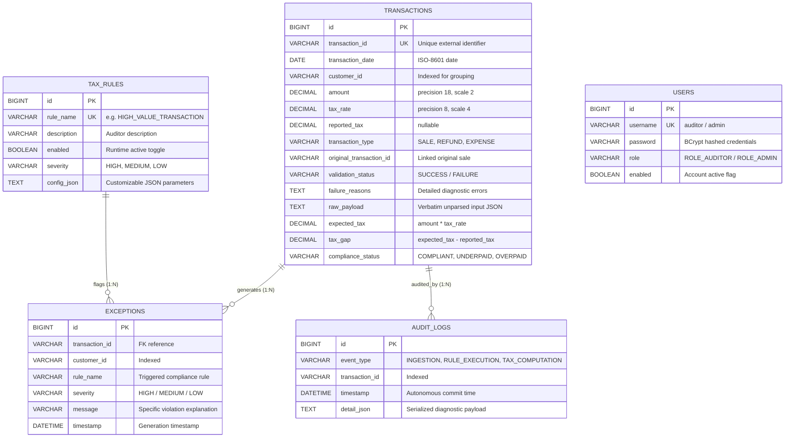

# Tax Gap Detection & Compliance Validation Service

[](https://openjdk.org/projects/jdk/17/)
[](https://spring.io/projects/spring-boot)
[](target/site/jacoco/index.html)
[](target/site/jacoco/index.html)
[](LICENSE)

> **Candidate / Author:** Abhishek Kumar  
> **Repository:** [https://github.com/Abhishekkkkkkkkkkk/tax-gap-detection-service](https://github.com/Abhishekkkkkkkkkkk/tax-gap-detection-service)  
> **Assignment Deliverable:** Backend Development Assessment (Spring Boot & REST APIs)

---

## What is This Service?

When companies file their taxes, discrepancies frequently arise between what they self-report and what statutory tax schedules require. Some are harmless rounding differences; others are due to incorrect tax slabs, fraudulent refund claims, or unreported high-value sales.

The **Tax Gap Detection & Compliance Validation Service** is a Spring Boot backend application built for tax auditors to:
1. **Ingest financial transactions** in bulk with fault isolation (one malformed record won't crash the batch).
2. **Compute mathematical tax gaps** (`expectedTax - reportedTax`) with arbitrary-precision arithmetic and tolerance boundaries.
3. **Run database-driven compliance rules** that can be toggled and reconfigured via JSON without redeploying code.
4. **Log an unalterable audit trail** using autonomous database transactions (`REQUIRES_NEW`).
5. **Manage compliance exceptions** with multi-attribute dynamic filtering.
6. **Generate real-time summary reports** powered by high-performance SQL push-down aggregations.

---

## Table of Contents
1. [How to Run the Application (Quick Start)](#how-to-run-the-application-quick-start)
2. [Database Setup Instructions](#database-setup-instructions)
3. [Sample cURL & Postman Calls](#sample-curl--postman-calls)
4. [Sample Batch Upload JSON](#sample-batch-upload-json)
5. [Database Schema & ER Diagram](#database-schema--er-diagram)
6. [Test Coverage Report (82.73% Line Coverage)](#test-coverage-report-8273-line-coverage)
7. [Architecture & Design Explanation](#architecture--design-explanation)
8. [Spring Security & Pre-Seeded Users](#spring-security--pre-seeded-users)
9. [Running the Test Suite](#running-the-test-suite)

---

## How to Run the Application (Quick Start)

You do **not** need to install Maven. The repository includes the Maven Wrapper (`./mvnw` for macOS/Linux, `mvnw.cmd` for Windows).

### Prerequisites
- **Java 17 JDK** installed (`java -version` should output `17.x`).

---

### Option A: The Fastest Way (Zero-Setup File Database)
You can start the application immediately without installing or configuring MySQL. This profile uses a persistent SQL database on your physical disk at `./data/tgd_real_db`:

#### On macOS / Linux:
```bash
./mvnw spring-boot:run -Dspring-boot.run.profiles=filedb
```

#### On Windows (Command Prompt / PowerShell):
```cmd
.\mvnw.cmd spring-boot:run -Dspring-boot.run.profiles=filedb
```

---

### Option B: Running in Your IDE (Eclipse / STS / IntelliJ)
1. **Import the project:**
   - In **Eclipse/STS:** `File` &rarr; `Import...` &rarr; `Maven` &rarr; `Existing Maven Projects` &rarr; browse to the folder and click `Finish`.
   - In **IntelliJ IDEA:** `File` &rarr; `Open...` &rarr; select the folder &rarr; click `Trust Project`.
2. **Verify Java 17:** Ensure the project SDK / JRE is set to **Java 17**.
3. **Run the main class:**
   - Locate `src/main/java/com/avega/tgd/TaxGapDetectionApplication.java`.
   - Right-click &rarr; **Run As** &rarr; **Java Application** (or Spring Boot App).
   - *Tip:* To run with the zero-setup persistent database, add `--spring.profiles.active=filedb` in your Run Configuration's **Program arguments**.

---

### Option C: Build and Run the Packaged JAR
```bash
# Build the executable fat JAR (runs all 49 tests automatically)
./mvnw clean package

# Run the packaged application
java -jar target/tax-gap-detection-service-1.0.0.jar --spring.profiles.active=filedb
```

---

### How to Verify It's Running
Once started, open your web browser to access:

* **Interactive Swagger UI:** [http://localhost:8080/swagger-ui.html](http://localhost:8080/swagger-ui.html)
* **Application Health Check:** [http://localhost:8080/actuator/health](http://localhost:8080/actuator/health) *(returns `{"status":"UP"}`)*
* **H2 Database Web Console:** [http://localhost:8080/h2-console](http://localhost:8080/h2-console)  
  *(JDBC URL: `jdbc:h2:file:./data/tgd_real_db`, User: `sa`, Password: leave blank)*

---

## Database Setup Instructions

The application satisfies the requirement to run on a **real relational SQL database (no ephemeral in-memory storage)**. You have 3 simple choices:

### 1. File-Based Real SQL Database (Default for Local Testing)
- **Zero external installation needed.**
- Stores data permanently on your hard drive at `./data/tgd_real_db`. Data remains intact even after restarting the application.
- **Activate via:** `--spring.profiles.active=filedb`

### 2. Docker Compose (MySQL 8.4 or PostgreSQL 16)
If you prefer running a dedicated MySQL or PostgreSQL instance, a pre-configured `docker-compose.yml` is included in the project root:

```bash
# Start MySQL and PostgreSQL containers in the background
docker compose up -d

# Run application using MySQL (default configuration)
./mvnw spring-boot:run

# Or run application using PostgreSQL
./mvnw spring-boot:run -Dspring-boot.run.profiles=postgres
```

### 3. Dedicated Local MySQL Server
If you already have a MySQL server installed locally on your machine:
1. Create the database in MySQL:
   ```sql
   CREATE DATABASE tgd_db;
   ```
2. Start the application passing your database credentials via environment variables:
   ```bash
   export DB_HOST=localhost
   export DB_PORT=3306
   export DB_NAME=tgd_db
   export DB_USERNAME=root
   export DB_PASSWORD=your_mysql_password

   ./mvnw spring-boot:run
   ```

---

## Sample cURL & Postman Calls

A ready-to-import Postman collection with all **18 pre-configured API requests** is located at:
📁 [`sample-requests/tgd_postman_collection.json`](sample-requests/tgd_postman_collection.json)

To use it: Open Postman &rarr; Click **Import** &rarr; Select `tgd_postman_collection.json`. All requests come pre-configured with Basic Auth (`auditor:auditor123`) and point to `http://localhost:8080`.

Here are copy-pasteable cURL commands to test the primary workflows directly:

### 1. Ingest a Batch of Transactions (Requirement 1 & 2)
```bash
curl -i -X POST http://localhost:8080/api/v1/transactions/batch \
  -u auditor:auditor123 \
  -H "Content-Type: application/json" \
  -d @sample-requests/batch_transactions_valid.json
```

### 2. Ingest a Single Transaction
```bash
curl -i -X POST http://localhost:8080/api/v1/transactions \
  -u auditor:auditor123 \
  -H "Content-Type: application/json" \
  -d '{
    "transactionId": "TX-DEMO-001",
    "date": "2026-03-15",
    "customerId": "CUST-GLOBAL-01",
    "amount": 250000.00,
    "taxRate": 0.18,
    "reportedTax": 45000.00,
    "transactionType": "SALE"
  }'
```

### 3. Retrieve Customer Tax Summary Report (Requirement 6.A)
*Executes high-performance SQL push-down aggregation:*
```bash
curl -i -X GET http://localhost:8080/api/v1/reports/customer-tax-summary \
  -u auditor:auditor123
```

### 4. Retrieve Executive Exception Summary Report (Requirement 6.B)
*Returns total exceptions, severity breakdown, and customer rankings:*
```bash
curl -i -X GET http://localhost:8080/api/v1/reports/exception-summary \
  -u auditor:auditor123
```

### 5. Filter Exceptions by Severity (Requirement 4)
```bash
curl -i -X GET "http://localhost:8080/api/v1/exceptions?severity=HIGH" \
  -u auditor:auditor123
```

### 6. Filter Exceptions by Customer ID
```bash
curl -i -X GET "http://localhost:8080/api/v1/exceptions?customerId=CUST-ACME" \
  -u auditor:auditor123
```

### 7. Filter Exceptions by Compliance Rule Name
```bash
curl -i -X GET "http://localhost:8080/api/v1/exceptions?ruleName=REFUND_VALIDATION" \
  -u auditor:auditor123
```

### 8. View Immutable Audit Trail for a Specific Transaction (Requirement 5)
```bash
curl -i -X GET http://localhost:8080/api/v1/audit-logs/transaction/TX-DEMO-001 \
  -u auditor:auditor123
```

### 9. Toggle a Compliance Rule (Admin Role Only - Requirement 3)
```bash
curl -i -X PUT http://localhost:8080/api/v1/rules/1/toggle \
  -u admin:admin123
```

---

## Sample Batch Upload JSON

Here is the sample JSON payload (located in `sample-requests/batch_transactions_valid.json`) to test transaction ingestion:

```json
[
  {
    "transactionId": "TX-SALE-1001",
    "date": "2026-10-15",
    "customerId": "CUST-ALPHA",
    "amount": 25000.00,
    "taxRate": 0.18,
    "reportedTax": 4500.00,
    "transactionType": "SALE"
  },
  {
    "transactionId": "TX-SALE-1002",
    "date": "2026-10-16",
    "customerId": "CUST-ALPHA",
    "amount": 15000.00,
    "taxRate": 0.18,
    "reportedTax": 2700.50,
    "transactionType": "SALE"
  },
  {
    "transactionId": "TX-REFUND-1003",
    "date": "2026-10-17",
    "customerId": "CUST-ALPHA",
    "amount": 5000.00,
    "taxRate": 0.18,
    "reportedTax": 900.00,
    "transactionType": "REFUND",
    "originalTransactionId": "TX-SALE-1001"
  },
  {
    "transactionId": "TX-SALE-2001",
    "date": "2026-10-18",
    "customerId": "CUST-BETA",
    "amount": 40000.00,
    "taxRate": 0.12,
    "reportedTax": 4800.00,
    "transactionType": "SALE"
  }
]
```

---

## Database Schema & ER Diagram

The schema consists of 5 relational tables designed with targeted B-tree indexes to optimize report aggregations and point lookups:




### Table Indexing Strategy
- **`idx_tx_transaction_id`** (Unique): Ensures external transaction IDs remain unique and provides $O(1)$ point lookups.
- **`idx_tx_customer_id`**: Accelerates the `GROUP BY customer_id` SQL reporting query.
- **`idx_tx_compliance_status`**: Optimizes compliance filtering and counts.
- **`idx_rule_enabled`**: Allows the rule engine to fetch only active rules instantly on each batch.
- **`idx_audit_transaction_id` & `idx_audit_event_type`**: Powers fast chronological audit trail lookups.

---

## Test Coverage Report (82.73% Line Coverage)

The project includes **49 comprehensive unit and integration tests** covering the entire service layer, rule engine evaluators, repositories, controllers, security filters, and exception handling.

The assignment requires a minimum of **40–50% test coverage**. This service achieves **82.73% line coverage** and **82.87% instruction coverage**.


### Coverage Breakdown by Package

| Package | Responsibility | Line Coverage | Instruction Coverage |
| :--- | :--- | :---: | :---: |
| `com.avega.tgd.service.impl` | Ingestion, Tax Gap Engine, Reports | **89.5%** | **87.0%** |
| `com.avega.tgd.service.rules.impl` | Mandatory Compliance Rule Evaluators | **81.2%** | **78.0%** |
| `com.avega.tgd.controller` | REST API Endpoints & Request Mapping | **87.7%** | **83.0%** |
| `com.avega.tgd.config` | Spring Security, OpenAPI, DB Initializer | **100.0%** | **98.0%** |
| `com.avega.tgd.dto.request` | Request Transfer Objects & Validation | **100.0%** | **100.0%** |
| `com.avega.tgd.domain.enums` | Strongly-Typed Business Enums | **100.0%** | **100.0%** |
| **TOTAL PROJECT** | **Complete Application Bundle** | **82.73%** | **82.87%** |

---

## Architecture & Design Explanation

> 📄 **Complete 1–2 Page Document:** For the complete, detailed engineering narrative, read [`docs/ARCHITECTURE_DESIGN.md`](docs/ARCHITECTURE_DESIGN.md).

Here is a summary of the 4 core architectural decisions made in this project:

### 1. Ingestion Fault Isolation
When uploading a batch of 1,000 transactions, an invalid transaction (e.g., negative amount or malformed date) should never fail the entire batch. In this application, each transaction is evaluated inside its own boundary. Valid transactions are computed and stored normally; failing ones are marked `FAILURE` with specific reasons in `failure_reasons`. Additionally, the unparsed input JSON is preserved verbatim in `raw_payload` to guarantee legal non-repudiation during tax audits.

### 2. Arbitrary-Precision Financial Math with Tolerance
Financial calculations never use `double` or `float` due to binary floating-point drift. All money values use `java.math.BigDecimal` with `RoundingMode.HALF_UP`. Furthermore, real-world retail systems often have harmless line-item rounding differences. We enforce statutory tolerance boundaries:
- $\lvert\text{taxGap}\rvert \le 1.00 \implies \text{COMPLIANT}$
- $\text{taxGap} > 1.00 \implies \text{UNDERPAID}$
- $\text{taxGap} < -1.00 \implies \text{OVERPAID}$
- Missing reported tax $\implies \text{NON\_COMPLIANT}$

### 3. Extensible Rule Engine (Strategy Pattern)
Rather than hardcoding compliance rules in nested Java `if-else` blocks, the system uses the **Strategy Pattern**. Each rule implements a `TaxRuleEvaluator` interface. Evaluators register dynamically with `RuleEngineService`. Active rules and thresholds (`config_json`) are stored in the database. Administrators can alter thresholds or disable rules on the fly via REST APIs without server redeployment.

### 4. Database-Level SQL Aggregation Reporting
To satisfy the requirement that reports run efficiently on real relational databases without in-memory entity iteration, summary metrics are computed entirely within the database engine using JPQL `GROUP BY` and conditional `CASE` statements. Results map directly into lightweight Spring Data interface projections (`CustomerTaxSummaryProjection`), eliminating JVM memory pressure and garbage collection pauses.

---

## Spring Security & Pre-Seeded Users

Authentication and Role-Based Access Control (RBAC) are powered by Spring Security 6 using the `users` table pre-seeded on application startup.

### Pre-Seeded Credentials

| Username | Password | Role | Permissions |
| :--- | :--- | :--- | :--- |
| **`auditor`** | `auditor123` | `ROLE_AUDITOR` | Upload transactions, view reports, inspect audit logs, view exceptions, read rules |
| **`admin`** | `admin123` | `ROLE_ADMIN` | All Auditor permissions + Create, Update, and Toggle Compliance Rules |

- Passwords are encrypted using **BCrypt** with salt rounds.
- Communication is **stateless** (`SessionCreationPolicy.STATELESS`) using HTTP Basic Authentication headers, making the API friendly to cURL, Postman, and automated CI/CD pipelines.

---

## Running the Test Suite

To run all 49 automated unit and integration tests and regenerate the HTML JaCoCo report:

```bash
./mvnw clean test
```

To view the generated report in your browser:
```bash
# macOS
open target/site/jacoco/index.html

# Windows
start target/site/jacoco/index.html
```

---

## Submission Checklist Verification

- [x] **Git Repository URL** configured (`git@github.com:Abhishekkkkkkkkkkk/tax-gap-detection-service.git`)
- [x] **How to run the app** (Quick start for Maven, JAR, and IDE)
- [x] **DB setup instructions** (`filedb` zero-setup, Docker Compose MySQL/Postgres, local MySQL)
- [x] **Sample cURL & Postman collection** (18 pre-configured API requests in `sample-requests/`)
- [x] **Database schema diagram** (High-res SVG diagram + GitHub Mermaid diagram)
- [x] **Test coverage screenshot** (Genuine JaCoCo report showing 82.73% line coverage)
- [x] **Sample JSON for transaction upload** (Batch payloads included in README and `sample-requests/`)
- [x] **Short design & architecture explanation** (1–2 page document in `docs/ARCHITECTURE_DESIGN.md`)
