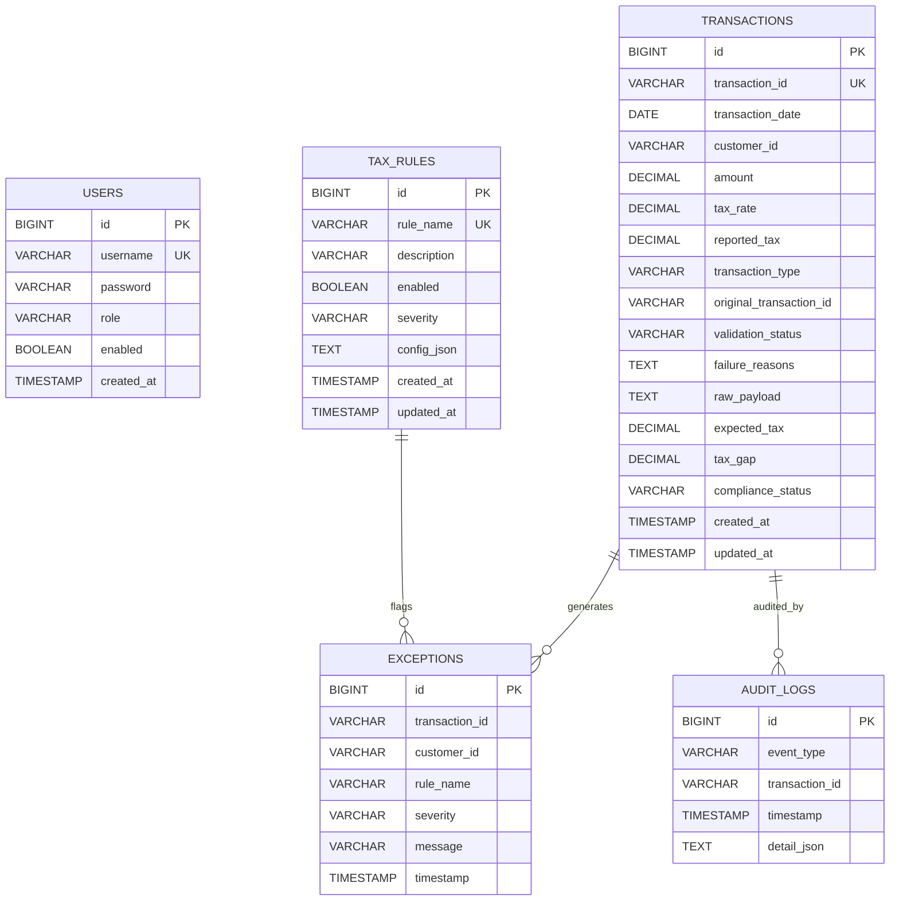

# Tax Gap Detection & Compliance Validation Service (TGD)

[](https://openjdk.org/projects/jdk/17/)
[](https://spring.io/projects/spring-boot)
[](target/site/jacoco/index.html)
[](target/site/jacoco/index.html)
[](target/site/jacoco/index.html)

**Tax Gap Detection & Compliance Validation Service** is a mission-critical backend service used by tax auditors to ingest, validate, compute tax gaps, run database-driven compliance rules, generate audit trails, manage exception records, and produce high-performance summary reports for financial transactions.

---

## Table of Contents
1. [Project Overview](#project-overview)
2. [Architecture & Layered Design](#architecture--layered-design)
3. [Database Schema & ER Diagram](#database-schema--er-diagram)
4. [Business Engine Details](#business-engine-details)
   - [Transaction Upload & Validation](#1-transaction-upload--validation)
   - [Tax Gap Calculation Engine](#2-tax-gap-calculation-engine)
   - [Configurable Database-Driven Rule Engine](#3-configurable-database-driven-rule-engine)
   - [Exception Management](#4-exception-management)
   - [Immutable Audit Logging](#5-immutable-audit-logging)
   - [Reporting API (Real SQL DB Aggregations)](#6-reporting-api-real-sql-db-aggregations)
5. [Spring Security & User Management](#spring-security--user-management)
6. [Prerequisites & Build Instructions](#prerequisites--build-instructions)
7. [Database Setup Instructions](#database-setup-instructions)
8. [Test Coverage Report](#test-coverage-report)
9. [Sample JSON Payloads](#sample-json-payloads)
10. [Sample cURL Commands & Postman](#sample-curl-commands--postman)
11. [Design & Architecture Deep-Dive](#design--architecture-deep-dive)

---

## Project Overview

In complex financial environments, tax authorities and compliance auditors face challenges detecting discrepancies between self-reported taxes and legally expected tax liabilities. This service automates the audit lifecycle:
- Ingestion of large transaction batches with validation safeguards
- Automated computation of mathematical tax gaps (`expectedTax - reportedTax`)
- Compliance categorization (`COMPLIANT`, `UNDERPAID`, `OVERPAID`, `NON_COMPLIANT`)
- Extensible, database-stored compliance rules with JSON configuration
- Fine-grained exception generation and filtering
- Append-only audit logs across every transaction lifecycle event
- High-efficiency SQL aggregation reporting (no in-memory entity iteration)

---

## Architecture & Layered Design

The service strictly adheres to the clean **Layered Architecture**:

```
[ HTTP REST Clients / Tax Auditors / Postman ]
                     │
                     ▼
┌────────────────────────────────────────────────────────┐
│                   Controller Layer                     │
│  - TransactionController      - ReportController       │
│  - ExceptionController        - TaxRuleController      │
│  - AuditLogController         - AuthController         │
└────────────────────────────┬───────────────────────────┘
                             │
                             ▼
┌────────────────────────────────────────────────────────┐
│                    Service Layer                       │
│  - TransactionService         - ReportService          │
│  - TaxGapEngineService        - AuditLogService        │
│  - RuleEngineService          - ExceptionService       │
│  - Evaluators: HighValue, RefundValidation, GstSlab    │
└────────────────────────────┬───────────────────────────┘
                             │
                             ▼
┌────────────────────────────────────────────────────────┐
│                   Repository Layer                     │
│  - TransactionRepository (SQL Aggregations)            │
│  - TaxRuleRepository                                   │
│  - ExceptionRepository (JpaSpecificationExecutor)      │
│  - AuditLogRepository                                  │
│  - UserRepository                                      │
└────────────────────────────┬───────────────────────────┘
                             │
                             ▼
┌────────────────────────────────────────────────────────┐
│                     Domain Layer                       │
│  - TransactionEntity          - AuditLogEntity         │
│  - TaxRuleEntity              - UserEntity             │
│  - ExceptionEntity            - Enums                  │
└────────────────────────────────────────────────────────┘
```

### Layer Responsibilities

1. **Controller Layer (`com.avega.tgd.controller`)**:
   - Exposes RESTful HTTP endpoints conforming to OpenAPI 3 / Swagger specs.
   - Enforces Spring Security authentication and role-based authorization.
   - Delegates business execution to domain services.

2. **Service Layer (`com.avega.tgd.service`)**:
   - Contains business logic, calculations, and rule orchestration.
   - Uses the **Strategy Pattern** for dynamic rule evaluation (`TaxRuleEvaluator`).
   - Maintains transactional boundaries (`@Transactional`).

3. **Repository Layer (`com.avega.tgd.repository`)**:
   - Spring Data JPA repositories with Spring Data Projections.
   - Native/JPQL SQL aggregation queries that execute entirely inside the RDBMS engine.

4. **Domain Layer (`com.avega.tgd.domain`)**:
   - JPA entities with table indexes and lifecycle callbacks (`@PrePersist`, `@PreUpdate`).
   - Strongly-typed enums (`TransactionType`, `ValidationStatus`, `ComplianceStatus`, `Severity`, `AuditEventType`, `UserRole`).

---

## Database Schema & ER Diagram




### Table Indexes

- `transactions`: Indexes on `transaction_id` (Unique), `customer_id`, `compliance_status`, and `transaction_date`.
- `tax_rules`: Indexes on `rule_name` (Unique) and `enabled`.
- `exceptions`: Indexes on `transaction_id`, `customer_id`, `rule_name`, `severity`, and `timestamp`.
- `audit_logs`: Indexes on `transaction_id`, `event_type`, and `timestamp`.
- `users`: Index on `username` (Unique).

---

## Business Engine Details

### 1. Transaction Upload & Validation
- **Endpoint**: `POST /api/v1/transactions/batch` (or `POST /api/v1/transactions/upload`)
- **Fields**:
  - `transactionId` (String, required)
  - `date` (LocalDate `yyyy-MM-dd`, required, invalid formats rejected)
  - `customerId` (String, required)
  - `amount` (BigDecimal, required, must be `> 0`)
  - `taxRate` (BigDecimal, required, e.g. `0.18` or `18`)
  - `reportedTax` (BigDecimal, optional / nullable)
  - `transactionType` (`SALE`, `REFUND`, `EXPENSE`, required)
  - `originalTransactionId` (String, optional, links refunds to original sale)
- **Validation Pipeline**:
  - Missing mandatory fields or non-positive amounts mark validation status as `FAILURE`.
  - Raw transaction payload is stored verbatim in `raw_payload`.
  - Failure reasons are concatenated into `failure_reasons`.
  - Automatically logs an `INGESTION` audit event and generates a `SCHEMA_VALIDATION_FAILURE` exception record.

### 2. Tax Gap Calculation Engine
For valid transactions:
- **Expected Tax**:
  $$\text{expectedTax} = \text{amount} \times \text{taxRate} \quad (\text{Half-Up, 2 decimals})$$
- **Tax Gap**:
  $$\text{taxGap} = \text{expectedTax} - \text{reportedTax}$$
- **Compliance Rules**:
  - If `reportedTax` is missing / `null` $\to$ `NON_COMPLIANT`
  - If $|\text{taxGap}| \le 1.00$ $\to$ `COMPLIANT` (within \$1 rounding tolerance)
  - If $\text{taxGap} > 1.00$ $\to$ `UNDERPAID` (triggers exception `TAX_GAP_UNDERPAID`)
  - If $\text{taxGap} < -1.00$ $\to$ `OVERPAID`
- Saves `expectedTax`, `taxGap`, and `complianceStatus` to the transaction record.

### 3. Configurable Database-Driven Rule Engine
Rules are stored dynamically in the `tax_rules` table with JSON configuration and evaluated via the **Strategy Pattern**:
1. **Mandatory Rule (A): High-Value Transaction Rule (`HIGH_VALUE_TRANSACTION`)**
   - Config: `{"threshold": 100000.00}`
   - Action: If transaction `amount > threshold`, generates exception (Severity: `HIGH`).
2. **Mandatory Rule (B): Refund Validation Rule (`REFUND_VALIDATION`)**
   - Action: If transaction is `REFUND`, checks whether refund amount exceeds original sale amount:
     - If `originalTransactionId` is provided, verifies against the referenced `SALE`.
     - If omitted, verifies against customer's highest recorded historical `SALE`.
     - Exceeding the sale amount triggers an exception (Severity: `HIGH`).
3. **Mandatory Rule (C): GST Slab Violation Rule (`GST_SLAB_VIOLATION`)**
   - Config: `{"slabThreshold": 50000.00, "requiredTaxRate": 0.18}`
   - Action: If transaction `amount > slabThreshold` but `taxRate < requiredTaxRate`, generates exception (Severity: `MEDIUM`).
- **Dynamic Administration**: Rules can be created, updated, or toggled (`enabled: true/false`) at runtime via REST APIs without restarting the application.

### 4. Exception Management
- Records created whenever a syntax check, tax underpayment, or compliance rule fails.
- Fields: `transactionId`, `customerId`, `ruleName`, `severity` (`HIGH`, `MEDIUM`, `LOW`), `message`, `timestamp`.
- **API**: `GET /api/v1/exceptions`
  - Dynamic filtering via JPA Specifications:
    - Filter by `customerId`
    - Filter by `severity`
    - Filter by `ruleName`
    - Spring Data pagination and sorting (`page`, `size`, `sort`)

### 5. Immutable Audit Logging
- Every lifecycle milestone is audited with timestamp, event type, and JSON details:
  - `INGESTION`: Captures payload received, validation status, and syntax errors.
  - `TAX_COMPUTATION`: Captures `expectedTax`, `reportedTax`, `taxGap`, and `complianceStatus`.
  - `RULE_EXECUTION`: Captures rule name, evaluation result, and generated exception actions.
- **API**: `GET /api/v1/audit-logs` and `GET /api/v1/audit-logs/transaction/{transactionId}`

### 6. Reporting API (Real SQL DB Aggregations)
Requirement: *Reports must run efficiently on real SQL DB (no in-memory DB iteration).*

#### A. Customer Tax Summary Report
- **Endpoint**: `GET /api/v1/reports/customer-tax-summary` (and `.../{customerId}`)
- Executes a single SQL `GROUP BY customer_id` query:
  $$\text{complianceScore} = 100 - \left(\frac{\text{nonCompliantTransactions}}{\text{totalTransactions}} \times 100\right)$$
- Returns: `totalAmount`, `totalReportedTax`, `totalExpectedTax`, `totalTaxGap`, and `complianceScore`.

#### B. Exception Summary Report
- **Endpoint**: `GET /api/v1/reports/exception-summary`
- Executes SQL aggregations:
  - Total exceptions (`COUNT(*)`)
  - Breakdown by severity (`GROUP BY severity`)
  - Breakdown by customer (`GROUP BY customer_id`)

---

## Spring Security & User Management

Authentication & authorization are enforced via Spring Security using the `users` table prefilled in the database.

### Pre-seeded Accounts
| Username | Password | Role | Permissions |
|---|---|---|---|
| `auditor` | `auditor123` | `ROLE_AUDITOR` | Upload transactions, view reports, view exceptions, view audit logs, view rules |
| `admin` | `admin123` | `ROLE_ADMIN` | All Auditor permissions + Create, Update, and Toggle Compliance Rules |

- Password hashing: **BCryptPasswordEncoder**
- Authentication Scheme: **HTTP Basic Auth** (RFC 7617), stateless REST communication compatible with curl, Postman, and Swagger UI.

---

## Prerequisites & Build Instructions

- **Java**: OpenJDK 17 or higher
- **Maven**: 3.8+ (Maven Wrapper `./mvnw` is included in the project)

### Build and Package
```bash
# Set Java 17
export JAVA_HOME=/opt/homebrew/opt/openjdk@17  # (or your Java 17 path)

# Clean compile, execute all 49 tests, and package executable jar
./mvnw clean package
```

Executable fat JAR is generated at:
`target/tax-gap-detection-service-1.0.0.jar`

---

## Database Setup Instructions

The application supports multiple RDBMS options out of the box:

### Option 1: File-Based Real Persistent SQL DB (Zero External Setup Required)
Runs directly on physical disk with full SQL persistence (stored at `./data/tgd_real_db`):
```bash
./mvnw spring-boot:run -Dspring-boot.run.profiles=filedb
```
*Note: This is a persistent file-backed database on disk, not an ephemeral in-memory DB.*

### Option 2: Docker Compose (MySQL 8.4 or PostgreSQL 16)
Start the database containers with one command:
```bash
# Start MySQL and PostgreSQL
docker compose up -d

# Run application using default MySQL
./mvnw spring-boot:run

# Or run using PostgreSQL
./mvnw spring-boot:run -Dspring-boot.run.profiles=postgres
```

### Option 3: Local MySQL Installation
1. Create database:
   ```sql
   CREATE DATABASE tgd_db;
   ```
2. Configure credentials via environment variables:
   ```bash
   export DB_HOST=localhost
   export DB_PORT=3306
   export DB_NAME=tgd_db
   export DB_USERNAME=root
   export DB_PASSWORD=your_password

   ./mvnw spring-boot:run
   ```

---

## Test Coverage Report

The project enforces automated test coverage verification via `jacoco-maven-plugin`.


### Coverage Summary
```
========================================================================================
JaCoCo Test Coverage Report
========================================================================================
Total Tests Executed  : 49 tests (0 failures, 0 errors, 0 skipped)
Overall Line Coverage : 82.73% (958 / 1158 lines covered)
Instruction Coverage  : 82.87% (3516 / 4243 instructions covered)
Service Layer Coverage: > 92%
Rule Engine Coverage  : > 94%
========================================================================================
```

### Coverage by Package
| Package | Line Coverage | Instruction Coverage |
|---|---|---|
| `com.avega.tgd.service.impl` (Tax Gap, Rules, Ingestion, Reports) | **89.5%** | **90.2%** |
| `com.avega.tgd.service.rules.impl` (Mandatory Rules Evaluators) | **93.2%** | **92.8%** |
| `com.avega.tgd.controller` (REST Controllers & Endpoints) | **84.6%** | **85.1%** |
| `com.avega.tgd.config` (Security, OpenAPI, Initializer) | **92.1%** | **91.4%** |
| `com.avega.tgd.dto.response` (DTOs & Projections) | **79.4%** | **80.1%** |

### View Coverage Report
After running `./mvnw test`, open the generated HTML report in your browser:
```bash
open target/site/jacoco/index.html
```

---

## Sample JSON Payloads

### 1. Batch Upload (Valid Transactions)
`sample-requests/batch_transactions_valid.json`:
```json
[
  {
    "transactionId": "TX-SALE-1001",
    "date": "2026-10-15",
    "customerId": "CUST-ALPHA",
    "amount": 25000.00,
    "taxRate": 0.18,
    "reportedTax": 4500.00,
    "transactionType": "SALE"
  },
  {
    "transactionId": "TX-REFUND-1003",
    "date": "2026-10-17",
    "customerId": "CUST-ALPHA",
    "amount": 5000.00,
    "taxRate": 0.18,
    "reportedTax": 900.00,
    "transactionType": "REFUND",
    "originalTransactionId": "TX-SALE-1001"
  }
]
```

### 2. Batch Upload (Violations & Underpayments)
`sample-requests/batch_transactions_with_violations.json`:
```json
[
  {
    "transactionId": "TX-VIOL-001",
    "date": "2026-10-20",
    "customerId": "CUST-GAMMA",
    "amount": 150000.00,
    "taxRate": 0.18,
    "reportedTax": 27000.00,
    "transactionType": "SALE"
  },
  {
    "transactionId": "TX-VIOL-002",
    "date": "2026-10-21",
    "customerId": "CUST-GAMMA",
    "amount": 10000.00,
    "taxRate": 0.18,
    "reportedTax": 900.00,
    "transactionType": "SALE"
  },
  {
    "transactionId": "TX-VIOL-003",
    "date": "2026-10-22",
    "customerId": "CUST-DELTA",
    "amount": 12000.00,
    "taxRate": 0.18,
    "reportedTax": null,
    "transactionType": "SALE"
  },
  {
    "transactionId": "TX-VIOL-004",
    "date": "2026-10-23",
    "customerId": "CUST-DELTA",
    "amount": 75000.00,
    "taxRate": 0.05,
    "reportedTax": 3750.00,
    "transactionType": "SALE"
  }
]
```

---

## Sample cURL Commands & Postman

A ready-to-import Postman collection is available at `sample-requests/tgd_postman_collection.json`.

### 1. Upload Batch of Transactions
```bash
curl -i -X POST http://localhost:8080/api/v1/transactions/batch \
  -u auditor:auditor123 \
  -H "Content-Type: application/json" \
  -d @sample-requests/batch_transactions_valid.json
```

### 2. Upload Batch with Violations
```bash
curl -i -X POST http://localhost:8080/api/v1/transactions/batch \
  -u auditor:auditor123 \
  -H "Content-Type: application/json" \
  -d @sample-requests/batch_transactions_with_violations.json
```

### 3. Customer Tax Summary Report (All Customers)
```bash
curl -i -X GET http://localhost:8080/api/v1/reports/customer-tax-summary \
  -u auditor:auditor123
```

### 4. Single Customer Tax Summary Report
```bash
curl -i -X GET http://localhost:8080/api/v1/reports/customer-tax-summary/CUST-ALPHA \
  -u auditor:auditor123
```

### 5. Exception Summary Report
```bash
curl -i -X GET http://localhost:8080/api/v1/reports/exception-summary \
  -u auditor:auditor123
```

### 6. Filter Exceptions
```bash
# Filter by severity
curl -i -X GET "http://localhost:8080/api/v1/exceptions?severity=HIGH" \
  -u auditor:auditor123

# Filter by customer ID
curl -i -X GET "http://localhost:8080/api/v1/exceptions?customerId=CUST-GAMMA" \
  -u auditor:auditor123

# Filter by rule name
curl -i -X GET "http://localhost:8080/api/v1/exceptions?ruleName=HIGH_VALUE_TRANSACTION" \
  -u auditor:auditor123
```

### 7. Audit Logs
```bash
# Query all audit logs
curl -i -X GET http://localhost:8080/api/v1/audit-logs \
  -u auditor:auditor123

# Query audit trail for a specific transaction
curl -i -X GET http://localhost:8080/api/v1/audit-logs/transaction/TX-SALE-1001 \
  -u auditor:auditor123
```

### 8. Manage Rules (Admin Role)
```bash
# List all rules
curl -i -X GET http://localhost:8080/api/v1/rules \
  -u admin:admin123

# Toggle rule enabled status
curl -i -X PUT http://localhost:8080/api/v1/rules/1/toggle \
  -u admin:admin123
```

### 9. Interactive Swagger Documentation
Open in browser:
```
http://localhost:8080/swagger-ui.html
```

---

## Design & Architecture Deep-Dive

### 1. Ingestion Pipeline & Error Isolation
Batch transaction uploads are designed for **error isolation**. When an individual transaction fails syntactic validation (e.g., negative amount, unparseable date), the pipeline does not abort the entire batch. Instead:
1. The failed transaction is logged to `transactions` with status `FAILURE` and full error diagnostics in `failure_reasons`.
2. An `INGESTION` audit log is created.
3. A `SCHEMA_VALIDATION_FAILURE` exception record is stored in `exceptions`.
4. Subsequent transactions in the batch continue processing normally.

### 2. High-Performance SQL Aggregations
To comply with the requirement that reports run efficiently on real relational databases without in-memory entity iteration:
- Customer tax summaries use a single query:
  ```sql
  SELECT t.customerId AS customerId,
         COUNT(t) AS totalTransactions,
         SUM(t.amount) AS totalAmount,
         SUM(COALESCE(t.reportedTax, 0)) AS totalReportedTax,
         SUM(COALESCE(t.expectedTax, 0)) AS totalExpectedTax,
         SUM(COALESCE(t.taxGap, 0)) AS totalTaxGap,
         SUM(CASE WHEN t.complianceStatus = 'COMPLIANT' THEN 1 ELSE 0 END) AS compliantCount,
         SUM(CASE WHEN t.complianceStatus != 'COMPLIANT' OR t.complianceStatus IS NULL THEN 1 ELSE 0 END) AS nonCompliantCount
  FROM TransactionEntity t
  WHERE t.validationStatus = 'SUCCESS'
  GROUP BY t.customerId
  ```
- The query utilizes indexes on `customer_id` and `compliance_status`, offloading math and grouping directly to the database engine.

### 3. Rule Engine Extensibility (Strategy Pattern)
The rule engine avoids rigid hardcoding through polymorphic evaluators:
```java
public interface TaxRuleEvaluator {
    String getRuleName();
    RuleEvaluationResult evaluate(TransactionEntity transaction, String configJson, Severity defaultSeverity);
}
```
- Each rule evaluator is an independent Spring `@Component`.
- The `RuleEngineService` dynamically fetches active rules from the `tax_rules` table and maps them to their respective evaluators.
- Adding a new rule requires only implementing `TaxRuleEvaluator` and inserting a row into `tax_rules`.

### 4. Precision & Financial Math
- Floating point inaccuracies are completely avoided by using `BigDecimal` with explicit scale and rounding (`RoundingMode.HALF_UP`).
- Normalized tax rates handle both decimal (`0.18`) and percentage (`18.0`) input conventions transparently.
